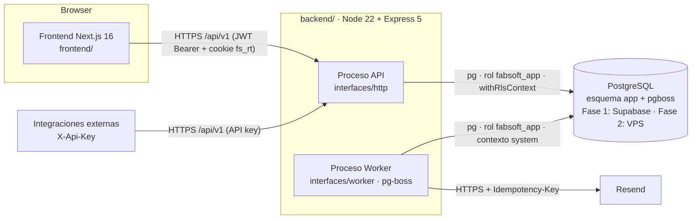

# Arquitectura — FabSoft

> Decisiones base: ADR-004 (RLS por transacción), ADR-006 (singleton acotado), ADR-007 (repositorio por caso de uso), ADR-008 (Supabase ahora + backend propio portable).

## 1. Vista general



- **Monolito modular**: un solo repositorio de backend y un solo despliegue lógico con **dos procesos** (API y worker) que comparten código.
- **Módulos funcionales**: `auth`, `users`, `clients`, `products`, `subscriptions`, `renewals` (solicitudes y tareas), `alerts` (reglas y notificaciones), `dashboard`, `portal`, `integrations`, `audit`, `settings`.
- Frontend separado (`frontend/`) que sólo habla con `/api/v1`.

## 2. Capas y regla de dependencias

```
interfaces  ──►  application  ──►  domain
infrastructure ─► application (implementa puertos) ─► domain
composition (root) conoce todo y ensambla
```

| Capa | Contiene | Puede importar | Nunca |
|---|---|---|---|
| `domain/` | Entidades (`Subscription`, `SubscriptionPeriod`, `RenewalRequest`, `Task`, `Notification`), value objects (`Money` COP, `LocalDate`, `BillingCycle`, `Scope`), máquina de estados, cálculo de periodos y fechas de alerta, errores de dominio. | Nada externo salvo `date-fns` puro. | `pg`, `express`, `process.env`, I/O. |
| `application/` | Casos de uso (un archivo por caso de uso), **puertos** (interfaces) que necesitan, DTOs de entrada/salida (Zod de `@fabsoft/shared`), políticas de autorización (`Authorizer`). | `domain`, `@fabsoft/shared`. | SQL, Express, SDKs. |
| `infrastructure/` | Adaptadores: `persistence/pg/*` (repos), `db/` (pool, `withRlsContext`, providers Supabase/Postgres), `queue/PgBossJobQueue`, `email/ResendEmailSender` y `LogEmailSender`, `security/` (`JoseTokenService`, `Argon2PasswordHasher`, `HmacApiKeyHasher`), `clock/SystemClock`, `logging/`. | `application` (puertos), `domain`. | `interfaces`. |
| `interfaces/` | `http/` (app Express, rutas `/api/v1`, controladores, middlewares, mapeo de errores a problem+json, registro OpenAPI) y `worker/` (registro de colas y crons, handlers que invocan casos de uso). | `application`, `@fabsoft/shared`. | `infrastructure` directo (lo recibe inyectado), SQL. |
| `composition/` | Composition root: construye singletons de infraestructura y casos de uso. | Todo. | Lógica de negocio. |

Las reglas se hacen cumplir con `no-restricted-imports` en `packages/config/eslint.config.js` y un test de arquitectura (`backend/tests/architecture/layers.test.ts`) que recorre imports.

## 3. Estructura de directorios del backend

```
backend/
├── src/
│   ├── domain/
│   │   ├── shared/            # LocalDate, Money, errores DomainError, Result
│   │   ├── subscriptions/     # subscription.ts, subscription-status.ts (máquina de estados),
│   │   │                      # billing-cycle.ts (calcula end_date), period.ts
│   │   ├── alerts/            # alert-rule.ts, alert-schedule.ts (fechas por regla), dedupe-key.ts
│   │   ├── renewals/          # renewal-request.ts, task.ts
│   │   └── integrations/      # manifest.ts (validación semántica), scope.ts
│   ├── application/
│   │   ├── shared/            # ActorContext, UnitOfWork, Clock, AuditWriter, JobQueue, Authorizer
│   │   ├── auth/              # login/, refresh-session/, logout/, change-password/, authenticate-api-key/
│   │   ├── clients/           # create-client/, update-client/, archive-client/, list-clients/, get-client/, ...
│   │   ├── products/
│   │   ├── subscriptions/     # create-subscription/, activate/, start-renewal/, renew-subscription/,
│   │   │                      # mark-not-renewed/, cancel-subscription/, correct-expiration/,
│   │   │                      # update-subscription/, update-period-payment/, list-subscriptions/, list-expiring/
│   │   ├── renewals/          # create-renewal-request/, resolve-renewal-request/, tasks/*
│   │   ├── alerts/            # reconcile-alerts/, dispatch-notifications/, expire-subscriptions/, retry-notification/
│   │   ├── dashboard/  portal/  integrations/  audit/  users/  settings/
│   │   └── <caso-de-uso>/{use-case.ts, ports.ts, dto.ts, use-case.test.ts}
│   ├── infrastructure/
│   │   ├── config/env.ts      # Zod sobre process.env, objeto congelado
│   │   ├── db/                # pool.ts, providers/{supabase.ts,postgres.ts}, with-rls-context.ts, pg-unit-of-work.ts
│   │   ├── persistence/pg/    # <módulo>/<PgXxxRepository>.ts + shared/mappers.ts
│   │   ├── queue/             # pg-boss-job-queue.ts
│   │   ├── email/             # resend-email-sender.ts, log-email-sender.ts, templates/
│   │   ├── security/          # jose-token-service.ts, argon2-password-hasher.ts, hmac-api-key-hasher.ts
│   │   ├── clock/  logging/
│   ├── interfaces/
│   │   ├── http/
│   │   │   ├── app.ts         # createApp(deps): Express
│   │   │   ├── middlewares/   # request-id, authenticate, require-role, require-scope, idempotency,
│   │   │   │                  # rate-limit, error-handler, not-found
│   │   │   ├── routes/v1/     # auth.ts, users.ts, clients.ts, products.ts, subscriptions.ts,
│   │   │   │                  # renewal-requests.ts, renewal-tasks.ts, notifications.ts, alert-rules.ts,
│   │   │   │                  # dashboard.ts, portal.ts, integrations.ts, audit-logs.ts, settings.ts, health.ts
│   │   │   └── openapi/       # registry.ts (zod-to-openapi)
│   │   └── worker/            # worker.ts (registro de colas/crons), handlers/*.ts
│   ├── composition/           # container.ts, modules/*.ts
│   ├── main-api.ts            # arranque API
│   └── main-worker.ts         # arranque worker
├── migrations/                # 0001_schema.sql, 0002_rls.sql (dbmate)
├── scripts/                   # seed.ts, create-admin.ts, generate-jwt-keys.ts
└── tests/                     # architecture/, contracts/, integration/, security/, api/, worker/, fixtures/
```

## 4. SOLID aplicado (con ejemplos)

### S — Responsabilidad única
Un caso de uso = una clase = una razón de cambio. `RenewSubscription` sólo orquesta la renovación; el cálculo de la nueva fecha está en `domain/subscriptions/billing-cycle.ts`, la autorización en `SubscriptionAuthorizer`, la persistencia en `PgRenewSubscriptionRepository` y el envío de correo en el worker.

```ts
// application/subscriptions/renew-subscription/use-case.ts
export class RenewSubscription {
  constructor(
    private readonly uow: UnitOfWork<RenewSubscriptionRepos>,
    private readonly authorizer: SubscriptionAuthorizer,
    private readonly clock: Clock,
  ) {}

  async execute(actor: ActorContext, input: RenewSubscriptionInput): Promise<SubscriptionDetailDto> {
    this.authorizer.assertCanRenew(actor);                       // admin | operator
    return this.uow.run(actor, async ({ renewals, alerts, tasks, requests, audit }) => {
      const current = await renewals.loadForRenewal(input.subscriptionId);
      if (!current) throw new NotFoundError('subscription');
      current.assertVersion(input.version);                      // 409 version_conflict
      const change = current.renew({                             // dominio: valida transición y periodo
        newPeriod: input.newPeriod, confirmedBy: actor.userId, now: this.clock.now(),
      });
      await renewals.saveRenewal(change);                        // cierra periodo, inserta nuevo, actualiza cabecera
      await alerts.cancelPendingForPeriod(change.subscriptionId, change.previousPeriodEnd, 'renewed');
      await alerts.scheduleForPeriod(change.subscriptionId, change.newPeriodEnd);
      await tasks.closeOpenRenewalTasks(change.subscriptionId, 'Renovación confirmada');
      await requests.resolveOpen(change.subscriptionId, 'renewed', actor.userId);
      await audit.record(actor, 'subscription.renewed', change.auditSnapshot());
      return change.toDetailDto();
    });
  }
}
```

### O — Abierto/cerrado
- **Canales de notificación**: `NotificationChannelHandler` (`InAppChannelHandler`, `EmailChannelHandler`). Añadir un canal es añadir un handler y registrarlo, sin tocar `DispatchNotifications`.
- **Ciclos de facturación**: `BillingCycle` mapea cada valor a una estrategia `addCycle(start)`; `custom` usa `custom_cycle_months`.
- **Middlewares** de autorización componibles (`requireRole('admin')`, `requireScope('subscriptions:read')`).

### L — Sustitución de Liskov
Toda implementación de un puerto respeta el mismo contrato observable y se prueba con la **misma suite de contrato**:
- `ResendEmailSender` y `LogEmailSender` → `emailSenderContract()` (idempotencia por clave, errores clasificados en `RetryableEmailError`/`PermanentEmailError`).
- `SupabasePoolerProvider` y `DirectPostgresProvider` → `connectionProviderContract()` (transacción, `set_config` local, liberación).
- Repositorio Pg y *fake* en memoria → `renewSubscriptionRepositoryContract()`.

### I — Segregación de interfaces
Puertos mínimos por caso de uso (ADR-007): `ListExpiringSubscriptions` depende de `ExpiringSubscriptionsQuery.findExpiring()` y nada más; el portal tiene sus propias consultas (`PortalSubscriptionsQuery`) que sólo proyectan campos autorizados, en vez de reutilizar el repositorio interno y "ocultar" campos después.

### D — Inversión de dependencias
`application` define las interfaces; `infrastructure` las implementa; `composition` las conecta:

```ts
// composition/modules/subscriptions.ts
export function subscriptionsModule(infra: Infra) {
  const uow = new PgUnitOfWork(infra.db, (tx) => ({
    renewals: new PgRenewSubscriptionRepository(tx),
    alerts:   new PgAlertSchedulingRepository(tx, infra.alertPolicy),
    tasks:    new PgRenewalTaskRepository(tx),
    requests: new PgRenewalRequestRepository(tx),
    audit:    new PgAuditWriter(tx),
  }));
  return { renewSubscription: new RenewSubscription(uow, new SubscriptionAuthorizer(), infra.clock) };
}
```

## 5. Puertos y adaptadores

| Puerto (`application/shared` o del caso de uso) | Adaptador | Notas |
|---|---|---|
| `UnitOfWork<R>` | `PgUnitOfWork` | Envuelve `withRlsContext` (ADR-004). |
| Repositorios/consultas por caso de uso | `Pg*Repository` / `Pg*Query` | SQL explícito, columnas explícitas. |
| `DatabaseConnectionProvider` | `SupabasePoolerProvider` · `DirectPostgresProvider` | **Único punto que cambia** al migrar a VPS (más variables de entorno). |
| `JobQueue` (`enqueue(name, payload, {tx})`, `schedule`) | `PgBossJobQueue` | Envío transaccional usando la misma conexión (`db` de pg-boss). |
| `EmailSender` | `ResendEmailSender` · `LogEmailSender` | Selección `EMAIL_TRANSPORT`. |
| `TokenService` | `JoseTokenService` | EdDSA + JWKS. |
| `PasswordHasher` | `Argon2PasswordHasher` | argon2id. |
| `ApiKeyHasher` | `HmacApiKeyHasher` | HMAC-SHA256 + pepper. |
| `Clock` | `SystemClock` · `FixedClock` (tests) | "Hoy" de negocio en America/Bogota. |
| `AuditWriter` | `PgAuditWriter` | Misma transacción que el cambio auditado; redacción de secretos. |
| `RateLimitStore` | memoria (`express-rate-limit`) | Sustituible si hay varias instancias. |

### Ciclo de una petición

1. `request-id` → `pino-http` → `helmet` → `cors` → `rate-limit`.
2. `authenticate`: JWT (`Authorization`) **o** API key (`X-Api-Key`); construye `ActorContext` (recarga estado del usuario o de la integración en contexto `system`).
3. `requireRole` / `requireScope` por ruta → `idempotency` en POST.
4. Controlador valida con Zod (`400 validation_error`) y llama al caso de uso con `(actor, input)`.
5. El caso de uso autoriza (reglas finas), abre `UnitOfWork` (contexto RLS), aplica dominio, persiste y audita.
6. Controlador mapea a DTO de respuesta (Zod `parse` en dev/test para detectar fugas de campos).
7. `error-handler` traduce `DomainError`/`AuthzError`/`pg` errors a `application/problem+json`.

## 6. Supabase hoy vs VPS mañana

| Aspecto | Fase 1 — Supabase | Fase 2 — VPS (PostgreSQL 16) | ¿Cambia código? |
|---|---|---|---|
| Conexión API | Supavisor modo transacción `:6543`, TLS con CA de Supabase | Conexión directa/local, TLS si cruza red | Sólo adaptador `DatabaseConnectionProvider` + env |
| Conexión worker | Supavisor modo sesión `:5432` o directa | Directa | Sólo env |
| Rol de la app | `fabsoft_app` (creado por 0002) con `LOGIN` asignado manualmente | Igual | No |
| Rol migrador | `postgres` de Supabase | `fabsoft_owner` (propietario, `BYPASSRLS`) | No (sólo `DATABASE_MIGRATION_URL`) |
| Migraciones | dbmate con los mismos archivos | Igual | No |
| RLS | Políticas portables `app.ctx_*()` | Igual | No |
| Auth | Propia (JWT/argon2) | Igual | No |
| Exposición PostgREST | Esquema `app` no expuesto; revocado a `anon`/`authenticated` | No existe | No |
| Backups | Gestionados por Supabase | `pg_dump` diario + archivado WAL | Operación |

## 7. Plan de migración Supabase → PostgreSQL en VPS (paso a paso)

**Preparación (sin corte)**
1. Aprovisionar VPS con Docker; levantar `postgres:16` con volumen dedicado, `max_connections` y `shared_buffers` dimensionados, acceso sólo por red privada o túnel.
2. Crear roles: `fabsoft_owner` (LOGIN, BYPASSRLS, propietario de la BD) y asignar `LOGIN PASSWORD` a `fabsoft_app` tras ejecutar migraciones.
3. Ejecutar `dbmate up` contra la BD vacía del VPS con `DATABASE_MIGRATION_URL` del VPS → esquema idéntico (verificar `dbmate status` = mismas versiones que Supabase).
4. Ejecutar la suite completa de integración y seguridad (`pnpm test:integration`, `pnpm test:security`) contra el VPS en staging.
5. Ensayo: restaurar un volcado de producción en staging-VPS, apuntar una API de staging (`DB_PROVIDER=postgres`) y pasar *smoke tests* + RLS.

**Corte (ventana estimada < 30 min con este volumen)**
6. Anunciar ventana; poner la API en modo mantenimiento (`MAINTENANCE_MODE=true` → `503` con `Retry-After` en escrituras) y **detener el worker**.
7. Volcado de datos de Supabase: `pg_dump --data-only --schema=app -Fc -f fabsoft_app.dump` con el rol `postgres` de Supabase. Excluir `pgboss` (los trabajos se regeneran con `alerts.reconcile`).
8. Restaurar en VPS como superusuario local (necesario por las FKs circulares `clients`↔`users` y los triggers de guarda): `pg_restore --data-only --schema=app --disable-triggers --single-transaction -d fabsoft fabsoft_app.dump`. Reajustar la identidad de `audit_logs` (`select setval(pg_get_serial_sequence('app.audit_logs','id'), max(id)) from app.audit_logs`).
9. Verificación: recuentos por tabla iguales, sumas de control (`count`, `max(updated_at)`) y consultas de muestreo; `dbmate status` idéntico.
10. Cambiar variables: `DB_PROVIDER=postgres`, `DATABASE_URL`, `WORKER_DATABASE_URL`, `DATABASE_SSL_*`. Desplegar API y worker.
11. Arrancar worker → ejecutar manualmente `alerts.reconcile` (idempotente) para recrear trabajos.
12. *Smoke tests*: login, listado de suscripciones, portal (aislamiento), integración con API key, `GET /api/v1/health/ready`.
13. Quitar modo mantenimiento.

**Post-corte**
14. Mantener Supabase en sólo lectura 14 días como respaldo (*rollback*: revertir variables y re-sincronizar los cambios del periodo desde `audit_logs`).
15. Activar backups del VPS (`docs/deployment.md` §5) y probar una restauración.
16. Revocar credenciales de Supabase en los secretos del despliegue.

## 8. Modelo de concurrencia

- Escrituras sobre suscripciones/tareas: bloqueo optimista con `version` + `SELECT ... FOR UPDATE` dentro de la transacción del caso de uso.
- Jobs: `FOR UPDATE SKIP LOCKED` + `locked_until`; todos idempotentes (no se asume ejecución única).
- Idempotencia HTTP: `idempotency_keys` (ver `docs/api/openapi.yaml`, cabecera `Idempotency-Key`).
