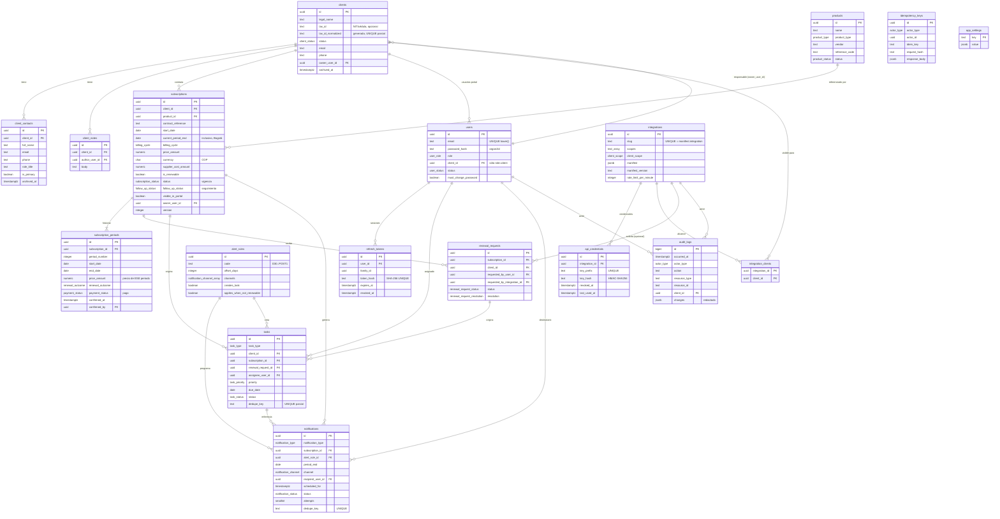
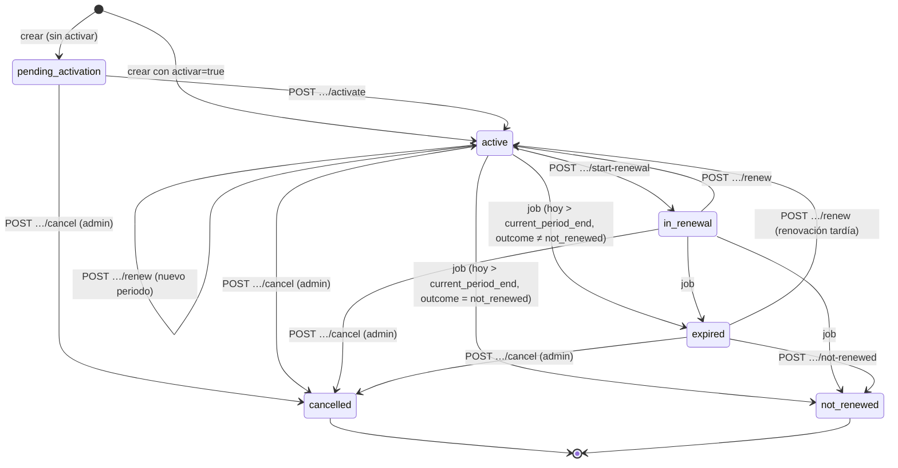

# Modelo de datos — FabSoft

> Fuente ejecutable: `backend/migrations/0001_schema.sql` (esquema) y `0002_rls.sql` (RLS). Si este documento y el SQL discrepan, **manda el SQL** y se corrige este documento en el mismo PR.

## 1. Convenciones

| Tema | Convención |
|---|---|
| Esquema | `app` (no `public`: Supabase expone `public` por PostgREST). pg-boss usa `pgboss`. |
| Nombres | Tablas en plural `snake_case`; JSON de la API en `camelCase` (mapeo en repositorios). |
| Claves | `uuid` con `gen_random_uuid()`; `audit_logs.id` es `bigint identity` (orden de inserción). |
| Fechas de negocio | `date` interpretado en **America/Bogota** (`start_date`, `current_period_end`, `due_date`). |
| Instantes | `timestamptz` en UTC (`created_at`, `sent_at`...). |
| Dinero | `numeric(14,2)` + `currency char(3)` con `CHECK (currency = 'COP')`. Admitir otra moneda = migración que relaje el CHECK (pregunta funcional 2). |
| Auditoría de fila | `created_at`, `updated_at` (trigger), `created_by`, `updated_by` donde aplica. |
| Borrado | **Sin borrado físico** en tablas con historia (RN-14): trigger `tg_prevent_delete` + `REVOKE DELETE`. Se usa `status`/`archived_at`. |
| Concurrencia | `version integer` en `subscriptions` y `tasks` (bloqueo optimista). |

## 2. Diagrama entidad-relación

## 3. Tipos enumerados

| Tipo | Valores | Etiqueta UI (es) |
|---|---|---|
| `user_role` | `admin`, `operator`, `client` | Administrador, Operador, Cliente |
| `user_status` | `active`, `disabled` | Activo, Desactivado |
| `client_status` | `active`, `inactive`, `archived` | Activo, Inactivo, Archivado |
| `product_type` | `third_party`, `own`, `recurring_service` | Tercero, Propio, Servicio recurrente |
| `product_status` | `active`, `inactive` | Activo, Inactivo |
| `billing_cycle` | `monthly`, `quarterly`, `semiannual`, `annual`, `biennial`, `custom` (+`custom_cycle_months`) | Mensual, Trimestral, Semestral, Anual, Bienal, Personalizada (N meses) |
| `subscription_status` | `pending_activation`, `active`, `in_renewal`, `expired`, `cancelled`, `not_renewed` | Pendiente de activación, Activa, En renovación, Vencida, Cancelada, No renovada |
| `payment_status` | `not_tracked`, `pending`, `received` | Sin seguimiento, Pendiente, Recibido |
| `follow_up_status` | `none`, `in_progress`, `awaiting_client`, `closed` | Sin gestión, En gestión, Esperando al cliente, Cerrado |
| `renewal_outcome` | `pending`, `renewed`, `not_renewed` | Pendiente, Renovada, No renovada |
| `renewal_request_status` | `pending_review`, `in_progress`, `resolved` | Pendiente de revisión, En gestión, Resuelta |
| `renewal_request_resolution` | `renewed`, `not_renewed`, `other` | Renovada, No renovada, Otro |
| `task_type` | `contact_client`, `send_proposal`, `confirm_terms`, `verify_payment`, `confirm_renewal`, `record_non_renewal`, `review_renewal_request`, `review_expired`, `other` | Contactar cliente, Preparar/enviar propuesta, Confirmar condiciones, Verificar orden de compra o pago, Confirmar renovación de licencia, Registrar motivo de no renovación, Revisar solicitud de renovación, Revisar suscripción vencida, Otra |
| `task_priority` | `low`, `medium`, `high`, `urgent` | Baja, Media, Alta, Urgente |
| `task_status` | `pending`, `in_progress`, `completed`, `cancelled` | Pendiente, En progreso, Completada, Cancelada |
| `notification_type` | `expiration_alert`, `renewal_request_created` | Alerta de vencimiento, Nueva solicitud |
| `notification_channel` | `in_app`, `email` | En la aplicación, Correo |
| `notification_status` | `pending`, `sent`, `failed`, `cancelled` | Pendiente, Enviada, Fallida, Cancelada |
| `integration_status` | `active`, `disabled` | Activa, Desactivada |
| `client_scope` | `all`, `own` | Todos los clientes, Clientes asignados |
| `actor_type` | `user`, `integration`, `system` | Usuario, Integración, Sistema |

## 4. Dimensiones separadas: vigencia, pago y seguimiento (RN-05, RN-06, RN-07)

| Dimensión | Dónde | Quién la cambia | Nunca |
|---|---|---|---|
| **Vigencia** `subscriptions.status` | Cabecera de la suscripción | Casos de uso explícitos (`activate`, `start-renewal`, `renew`, `cancel`) y el job `subscriptions.expire` | Cambiar al abrir una pantalla; inferirse del pago. |
| **Pago** `subscription_periods.payment_status` | Por periodo | Admin/operador con `PATCH /subscriptions/{id}/periods/{periodId}` | Inferirse de la fecha; marcarse `received` al renovar. |
| **Seguimiento** `subscriptions.follow_up_status` + `subscription_periods.renewal_outcome` + `renewal_requests.status` | Cabecera / periodo / solicitud | Casos de uso de renovación y tareas | Confundir solicitud con renovación confirmada. |

### Máquina de estados de vigencia

- `POST /subscriptions/{id}/not-renewed` sobre una suscripción **aún vigente** registra la decisión en el periodo actual (`renewal_outcome='not_renewed'`, `outcome_reason`) y cierra el seguimiento; el estado sigue `active`/`in_renewal` hasta el fin del periodo y el job la pasa a `not_renewed` (no a `expired`). Sobre una suscripción `expired` el cambio es inmediato.
- `cancelled` y `not_renewed` son terminales; continuar requiere una suscripción nueva (conserva historial separado).
- `follow_up_status`: `in_progress` al iniciar renovación; `awaiting_client` cuando el operador lo marca (tarea en espera de respuesta); `closed` al renovar, no renovar o cancelar; vuelve a `none` cuando empieza el nuevo periodo.

## 5. Convención de fechas y periodos (RN-03)

- `current_period_end` y `subscription_periods.end_date` son el **último día inclusivo** de vigencia en America/Bogota.
- Una suscripción está **vencida** cuando `hoy_bogota > current_period_end`.
- Periodo siguiente por defecto: `start = end_anterior + 1 día`; `end = start + ciclo − 1 día` (p. ej. anual del 2026-01-01 → 2026-12-31). Fin de mes: `date-fns addMonths` (31-ene + 1 mes = 28/29-feb).
- **Invariante:** `subscriptions.current_period_end = max(subscription_periods.end_date)` de la suscripción; lo garantizan los casos de uso `create`, `renew` y `correct-expiration` en la misma transacción, y lo verifica el test `T-RN03-02`.
- Crear una suscripción crea su periodo 1 (`start_date`..`current_period_end`, precio y ciclo iniciales).

## 6. `subscription_periods` (historial, RN-04)

- Inmutable salvo: `renewal_outcome`, `outcome_reason`, `confirmed_at`, `confirmed_by`, `payment_status`, `contract_reference` y `end_date` **sólo del último periodo** (corrección, Flujo E). Lo impone el trigger `tg_subscription_periods_guard`.
- Sin solapes entre periodos de una suscripción (trigger, `errcode 23P01`) y `UNIQUE (subscription_id, period_number)` y `(subscription_id, start_date)`.
- Cada periodo guarda su `price_amount`, `billing_cycle` y `supplier_cost_amount`: el historial nunca muestra condiciones actuales como si siempre hubieran existido (§6.5).
- Al renovar: periodo actual → `renewal_outcome='renewed'`, `confirmed_at/by`; nuevo periodo → `period_number+1`, `renewal_outcome='pending'`, `payment_status='pending'` (o `not_tracked` si se indica).

## 7. Constraints relevantes

| Tabla | Constraint | Regla |
|---|---|---|
| `users` | `CHECK ((role='client') = (client_id IS NOT NULL))` | Usuario de portal ligado a un cliente; interno nunca. |
| `clients` | `UNIQUE (tax_id_normalized) WHERE NOT NULL` | Evita duplicados evidentes por NIT (§6.2). Normaliza `900.123.456-7` = `9001234567`. |
| `clients` | `CHECK ((status='archived') = (archived_at IS NOT NULL))` | Archivado coherente. |
| `subscriptions` | `CHECK (current_period_end >= start_date)`, `CHECK (currency='COP')`, `CHECK ((billing_cycle='custom') = (custom_cycle_months IS NOT NULL))`, `UNIQUE (id, client_id)` | Coherencia y FK compuestas. |
| `renewal_requests` | `FK (subscription_id, client_id) → subscriptions(id, client_id)` | La solicitud es del mismo cliente que la suscripción. |
| `renewal_requests` | exactamente uno de `requested_by_user_id` / `requested_by_integration_id` | Trazabilidad del solicitante. |
| `tasks` | `FK (subscription_id, client_id) → subscriptions(id, client_id)` | Tarea coherente con cliente. |
| `tasks` | `UNIQUE (dedupe_key) WHERE NOT NULL` | Tareas automáticas idempotentes. |
| `notifications` | `UNIQUE (dedupe_key)` | RN-08. |
| `alert_rules` | `UNIQUE (code)`, `UNIQUE (offset_days)` | Una regla por anticipación. |
| `integrations` | `scopes <@ {lista blanca}` | Sólo scopes conocidos. |
| `audit_logs` | coherencia `actor_type` ↔ `actor_*_id`; trigger append-only | RN-13. |

## 8. Índices (y consulta que soportan)

| Índice | Consulta |
|---|---|
| `subscriptions_expiring_idx (current_period_end) WHERE status IN ('active','in_renewal')` | `GET /subscriptions/expiring`, dashboard 30/15/7, job de vencimiento. |
| `subscriptions_client_idx`, `_product_idx`, `_owner_idx`, `_status_idx` | Filtros de `GET /subscriptions`. |
| `clients_legal_name_lower_idx`, `clients_tax_id_normalized_uq` | Búsqueda previa a crear (Flujo A). |
| `tasks_assignee_status_due_idx`, `tasks_open_due_idx` | Filtros de tareas; tareas vencidas/próximas. |
| `notifications_due_idx (scheduled_for, next_attempt_at) WHERE status='pending'` | Dispatcher del worker. |
| `notifications_recipient_idx` | Bandeja in-app del usuario. |
| `renewal_requests_status_idx`, `_client_status_idx` | Solicitudes nuevas (dashboard) y portal. |
| `audit_logs_resource_idx`, `_client_idx`, `_occurred_idx` | Historial por recurso/cliente; actividad reciente. |
| `api_credentials_prefix_uq` | Autenticación de API key. |
| `refresh_tokens_hash_uq`, `_family_idx` | Rotación y revocación por familia. |

## 9. Soft-delete y archivado

| Entidad | Mecanismo | Efecto |
|---|---|---|
| `clients` | `status='archived'` + `archived_at` (admin) / `inactive` | Historial intacto; no aparece en listas por defecto (`status=active,inactive`); no se crean nuevas suscripciones. |
| `client_contacts` | `archived_at` | Se oculta; se conserva. |
| `products` | `status='inactive'` | No seleccionable para nuevas suscripciones; las existentes siguen. |
| `subscriptions` | `cancelled` / `not_renewed` | Terminales, sin borrado. |
| `users` | `status='disabled'` | Revoca refresh tokens; JWT vigente deja de servir en la siguiente petición. |
| `integrations` / `api_credentials` | `disabled` / `revoked_at` | Acceso cortado inmediatamente. |
| `notifications` | `cancelled` | Conserva motivo (`cancel_reason`). |
| `audit_logs` | append-only | Nunca se modifica ni borra. |

Borrado físico permitido sólo en: `refresh_tokens` y `idempotency_keys` (limpieza técnica) e `integration_clients` (quitar un cliente del alcance; se audita).

## 10. Datos de referencia creados por migración

- `alert_rules`: `D30`, `D15`, `D7`, `D1`, `D0`, `POST1` (ver `docs/notifications.md` §2).
- `app_settings.contact_channel`: canal de contacto mostrado en el portal (valor de ejemplo `contacto@fabsoft.example`, **debe configurarse** por el admin).
