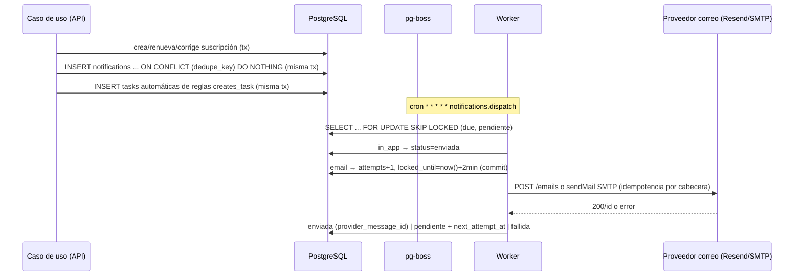
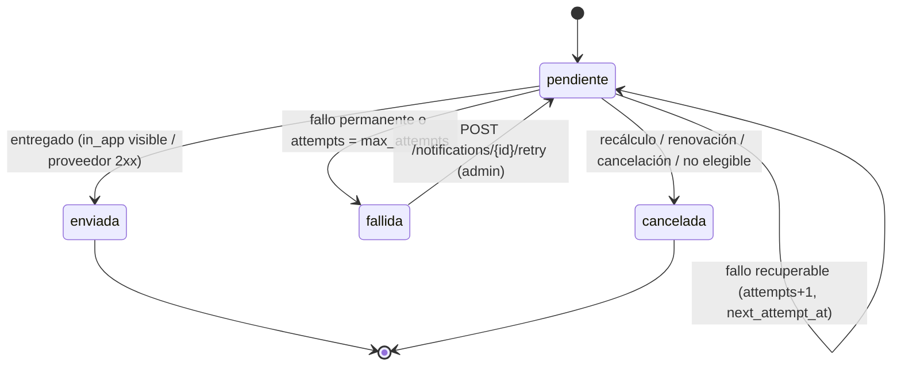

# Alertas y notificaciones — FabSoft

> Decisión: ADR-005 (correo detrás de worker pg-boss). Tabla: `app.notifications`. Reglas: RN-08, RN-09, RN-10. Funcional §6.7 y Flujo B.

## 1. Conceptos

- **Alerta** = fila en `notifications` (informa). **Tarea** = fila en `tasks` (acción). Una regla puede crear ambas, pero son entidades distintas (§4 funcional).
- Cada alerta tiene **canal** (`in_app` siempre disponible; `email` vía Resend o SMTP) y **destinatario** (`recipient_user_id`).
- La BD es la única fuente de verdad de fechas (no calendarios externos).

## 2. Política por defecto (configurable en `/api/v1/alert-rules`)

| Código | `offset_days` | Momento | Propósito (§6.7) | Canales | Crea tarea |
|---|---|---|---|---|---|
| `D30` | 30 | 30 días antes | Preparar la renovación | in_app, email | `send_proposal` (media) |
| `D15` | 15 | 15 días antes | Contactar al cliente | in_app, email | `contact_client` (alta) |
| `D7` | 7 | 7 días antes | Hacer seguimiento | in_app, email | — |
| `D1` | 1 | 1 día antes | Vencimiento inminente | in_app, email | — |
| `D0` | 0 | Día del vencimiento | Comprobar el estado | in_app | — |
| `POST1` | −1 | 1 día después | Requiere revisión | in_app, email | `review_expired` (urgente) |

- **Fecha programada:** `scheduled_for = (current_period_end − offset_days) a las 08:00 America/Bogota` (13:00 UTC).
- **Destinatarios** (pregunta funcional 8 pendiente; regla inicial): responsable de la suscripción (`subscriptions.owner_user_id`) → si es nulo, responsable del cliente (`clients.owner_user_id`) → si es nulo, todos los admins activos. Sólo usuarios internos activos.
- Las tareas automáticas se asignan al mismo destinatario principal, con `due_date = fecha de la alerta + 2 días` (y nunca posterior al vencimiento para reglas previas).
- **Email:** habilitado por regla (`channels`) y globalmente por `CORREO_CANAL=resend|smtp`. Con `CORREO_CANAL=log` (dev/test) el envío se escribe en log y se marca `enviada`.
- **Plantilla:** asunto y cuerpo editables desde `/admin/alert-rules` mediante `GET/PATCH /api/v1/alert-rules/email-template`; se guardan en `app_settings` (`key=alert_email_template`) y el worker las aplica a los correos de vencimiento. Placeholders: `{{recipientName}}`, `{{clientName}}`, `{{productName}}`, `{{periodEnd}}`, `{{ruleCode}}`, `{{subscriptionUrl}}`, `{{frontendUrl}}`. `/alert-rules` configura además umbrales, canales, creación de tarea y excepción RN-10.

## 3. Programación (scheduling)



1. **En línea (misma transacción del caso de uso):** al crear, activar, renovar o corregir una suscripción se insertan las notificaciones del periodo vigente para todas las reglas activas aplicables cuya fecha programada sea **≥ hoy** (no se generan alertas retroactivas de anticipaciones ya pasadas; la regla más próxima no vencida sí). En la misma transacción se crean las tareas automáticas de las reglas con `creates_task` (`dedupe_key = alert:<subscription_id>:<rule_code>:<period_end>`), asignadas al destinatario principal.
2. **Reconciliación (`alerts.reconcile`, diaria 00:10 Bogotá):** recorre suscripciones `activa`/`en_renovacion`/`vencida` y:
   - inserta las faltantes (`ON CONFLICT DO NOTHING`);
   - cancela pendientes cuyo `period_end` ≠ `current_period_end`, cuya regla está inactiva o cambió de `offset_days`, o cuya suscripción ya no es elegible (RN-10).
3. **Elegibilidad (RN-10):** `status ∉ {cancelada, no_renovada, pendiente_activacion}` y (`is_renewable = true` y `renewal_outcome` del periodo vigente ≠ `no_renovada`) **o** `alert_rules.applies_when_not_renewable = true`. Las reglas `D0`/`POST1` aplican también a `vencida`.

### Clave de idempotencia (RN-08)

```
exp:<subscription_id>:<rule_code>:<period_end YYYY-MM-DD>:<channel>:<recipient_user_id>
rr:<renewal_request_id>:<channel>:<recipient_user_id>
```

Una misma regla nunca produce dos filas para la misma suscripción y periodo (y canal/destinatario). Si cambia `period_end`, la clave cambia: las antiguas se cancelan y se crean nuevas.

## 4. Estados



- `enviada` y `cancelada` son finales. `fallida` es reintentable manualmente.
- **Un fallo nunca borra la alerta** (§6.7): queda con `last_error` (texto truncado a 2000 caracteres, sin datos personales del cuerpo del correo) y `attempts`.
- Las alertas `in_app` visibles al usuario son las `enviada`; `read_at` marca lectura.

## 5. Reintentos y backoff (canal email)

| Intento | Espera antes del siguiente |
|---|---|
| 1 → 2 | 1 min |
| 2 → 3 | 5 min |
| 3 → 4 | 30 min |
| 4 → 5 | 2 h |
| 5 | → `fallida` |

- Jitter ±20 % para no sincronizar reintentos. `max_attempts` por defecto 5 (1–10).
- **Clasificación de errores** (`ResendEmailSender` o `SmtpEmailSender`):
  - Recuperables: timeout/red, HTTP 429 (respeta `Retry-After` si es mayor que el backoff), 5xx, códigos SMTP 4xx.
  - Permanentes ⇒ `fallida` inmediato: 400/401/403/404/422 (p. ej. dirección inválida, dominio no verificado, clave inválida), `EAUTH`/`EENVELOPE`/`EMESSAGE` y códigos SMTP 5xx.
- **Selección de proveedor:** `CORREO_CANAL=log|resend|smtp`. El worker sólo depende del puerto `EmailSender`; `createEmailSender` inyecta `ResendEmailSender`, `SmtpEmailSender` o `LogEmailSender`. Cambiar de proveedor es cambiar variables, no código.
- **Caída del worker tras enviar y antes de marcar `enviada`:** `locked_until` expira (2 min) y la fila se vuelve a reclamar; Resend deduplica por `Idempotency-Key` durante 24 h. En SMTP la cabecera `X-Idempotency-Key` es informativa y el servidor puede no deduplicar.
- **Límite de tasa:** `RESEND_MAX_RPS` (por defecto 2) aplicado sólo al adaptador Resend; el lote por ejecución es de 50 notificaciones.

## 6. Recálculo

| Evento | Acción sobre alertas | Acción sobre tareas |
|---|---|---|
| `POST /subscriptions` (activa) / `POST /subscriptions/{id}/activate` | Programar periodo vigente | — |
| `POST /subscriptions/{id}/renew` | Cancelar `pendiente` del periodo anterior (`renewed`); programar el nuevo | Completar abiertas automáticas del periodo anterior con resultado "Renovación confirmada"; resolver solicitudes abiertas |
| `POST /subscriptions/{id}/correct-expiration` | Cancelar `pendiente` con `period_end` antiguo (`period_end_changed`); programar el nuevo | Cancelar automáticas `pendiente` del periodo antiguo; las `en_progreso` se conservan con nota añadida |
| `POST /subscriptions/{id}/not-renewed` | Cancelar `pendiente` de reglas sin excepción (`not_renewed`) | Cerrar automáticas de renovación; crear `record_non_renewal` sólo si no hay motivo |
| `POST /subscriptions/{id}/cancel` | Cancelar todas las `pendiente` (`subscription_cancelled`) | Cancelar todas las abiertas de la suscripción |
| `PATCH isRenewable=false` | Cancelar `pendiente` sin excepción | — |
| `PATCH isRenewable=true` | Programar las que correspondan | — |
| `PATCH /alert-rules/{id}` | La siguiente reconciliación diaria reprograma pendientes si cambia el umbral y cancela canales retirados o reglas inactivas | — |
| Job `subscriptions.expire` | Nada que cancelar (las `D0`/`POST1` siguen válidas) | — |

## 7. Notificaciones por evento

- `renewal_request_created`: al crear la solicitud, un proceso de sistema idempotente (`ProcessRenewalRequestCreated`) crea la tarea `review_renewal_request` (`dedupe_key = request:<id>`, prioridad alta, vence en 2 días) y notificaciones `in_app` + `email` para el responsable de la suscripción (o del cliente, o admins). La operación se puede reintentar sin duplicar la tarea ni las notificaciones.

## 8. Contenido del correo

- Plantilla editable en `app_settings` con asunto y cuerpo en texto plano; placeholders permitidos: cliente, producto, fecha de vencimiento, regla, enlace a la suscripción y URL del frontend. El contenido por defecto se mantiene en `DEFAULT_ALERT_EMAIL_TEMPLATE` y se usa si aún no hay configuración guardada.
- Sin precio ni costo en el correo (minimizar datos sensibles en buzones).
- Remitente `CORREO_DESDE` en un dominio verificado en Resend o autorizado por el servidor SMTP.

## 9. Observabilidad

Métricas derivadas (ver `docs/observability.md`): pendientes vencidas > 15 min, `fallida` en 24 h, edad del último `dispatch` exitoso. El dashboard interno muestra un aviso si hay alertas `fallida`.
