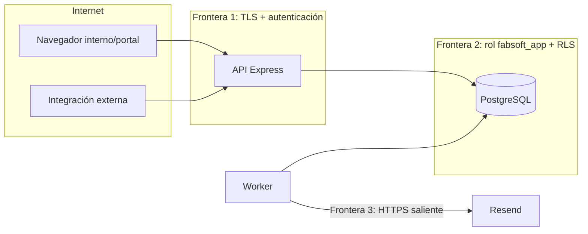

# Modelo de amenazas — FabSoft

> Alcance: API (`backend/`, proceso API), worker, base de datos (Supabase hoy, VPS mañana), frontend Next.js, integraciones externas y Resend. Metodología STRIDE. Revisar en cada cambio de autenticación, RLS, endpoints de escritura o proveedor de infraestructura.

## 1. Activos y fronteras de confianza

| Activo | Sensibilidad | Dónde vive |
|---|---|---|
| Datos de clientes (razón social, NIT, contactos) | Media-alta (datos personales, Ley 1581 de 2012 de Colombia) | `clients`, `client_contacts` |
| Condiciones comerciales (precio, **costo de proveedor**) | Alta (confidencial comercial) | `subscriptions`, `subscription_periods` |
| Credenciales humanas | Crítica | `users.password_hash` (argon2id), `refresh_tokens.token_hash` |
| Credenciales de integración | Crítica | `api_credentials.key_hash` (HMAC) + `API_KEY_PEPPER` |
| Claves de firma JWT | Crítica | Secretos del despliegue (`JWT_PRIVATE_KEY`) |
| Auditoría | Alta (integridad) | `audit_logs` (append-only) |
| Secretos de infraestructura | Crítica | `DATABASE_URL`, `RESEND_API_KEY`, etc. |

## 2. STRIDE

| # | Categoría | Amenaza | Mitigaciones | Test |
|---|---|---|---|---|
| S1 | Spoofing | Robo/adivinanza de contraseñas | argon2id; rate limit 5/min por IP+email y 20/min por IP en `/auth/login`; mensajes genéricos; contraseña mínima 12; cambio obligatorio de contraseña temporal; auditoría `auth.login_failed` (sin la contraseña). | `T-AUTH-04` |
| S2 | Spoofing | Robo de access token (XSS) | Access token sólo en memoria (no `localStorage`), TTL 15 min; CSP en frontend; React escapa por defecto; prohibido `dangerouslySetInnerHTML` (lint). | `T-FE-01` |
| S3 | Spoofing | Robo/reutilización de refresh token | Cookie `HttpOnly; Secure; SameSite=Strict; Path=/api/v1/auth`; hash SHA-256 en BD; rotación en cada uso; reutilización ⇒ revoca familia. | `T-AUTH-01`, `T-AUTH-02` |
| S4 | Spoofing | Integración usa credenciales humanas o viceversa | Mecanismos separados (ADR-001); ambas credenciales ⇒ `400`; `actor_type` distinto en contexto RLS. | `T-API-02` |
| S5 | Spoofing | API key filtrada | HMAC+pepper (volcado de BD inútil); prefijo identificable para escaneo de secretos; revocación inmediata; expiración opcional (`credential_ttl_days`); máximo 2 activas para rotar. | `T-API-01` |
| S6 | Spoofing | Falsificación de JWT | EdDSA con clave privada sólo en la API; verificación de `iss`, `aud`, `exp`, `alg` fijo (`EdDSA`), `kid` en JWKS conocido. | `T-AUTH-05` |
| T1 | Tampering | Cliente modifica precio, fechas, estado o pago | El portal sólo expone lectura + `POST /portal/renewal-requests`; RLS sin políticas de UPDATE para `client` en `subscriptions`/`subscription_periods`; DTO de entrada con `additionalProperties: false`. | `T-RN11-02` |
| T2 | Tampering | Usuario cliente escala su rol | Trigger `users_guard_privileged` (sólo admin/system cambian `role`, `status`, `client_id`, `email`); el rol se recarga desde BD en cada petición. | `T-SEC-03` |
| T3 | Tampering | Reescritura del historial | Trigger de inmutabilidad en `subscription_periods`; `REVOKE DELETE` + `tg_prevent_delete`; `audit_logs` append-only. | `T-RN04-02`, `T-RN14-01` |
| T4 | Tampering | Inyección SQL | Sólo consultas parametrizadas (`pg`); `set_config` con parámetros; columnas de ordenación por lista blanca; lint que prohíbe interpolar en SQL. | `T-SEC-04` |
| T5 | Tampering | CSRF sobre el refresh | `SameSite=Strict`; `/auth/refresh` exige además cabecera `X-Requested-With: fabsoft-web`; CORS con lista blanca exacta. | `T-AUTH-06` |
| T6 | Tampering | Manipulación de manifest de integración | Sólo admin; validación Zod + reglas semánticas (scopes conocidos, `client_ids` existentes, semver creciente); auditoría con diff. | `T-INT-01` |
| R1 | Repudio | "Yo no renové / no cambié la fecha" | `audit_logs` en la misma transacción que el cambio, con actor, `request_id`, IP y antes/después; append-only. | `T-RN13-01` |
| R2 | Repudio | Integración niega haber creado una solicitud | `requested_by_integration_id` + auditoría `renewal_request.created` con `actor_type='integration'`; `Idempotency-Key` registrada. | `T-RN12-02` |
| I1 | Info. disclosure | Acceso cruzado entre clientes (portal) | Autorización en `application` (clientId del contexto) + RLS `client_id = app.ctx_client_id()`; 404 (no 403) para recursos ajenos. | `T-RN11-01`, suite RLS |
| I2 | Info. disclosure | Integración ve clientes fuera de su alcance | `client_scope='own'` + `integration_clients` en RLS (`app.integration_sees_client`). | `T-RN12-01` |
| I3 | Info. disclosure | Fuga de campos internos (costo, notas) | Proyecciones DTO específicas (portal/integración) con columnas explícitas; test de contrato que falla si aparecen `supplierCostAmount`/`notes`. | `T-SEC-05` |
| I4 | Info. disclosure | Secretos en logs/auditoría | `pino` `redact` (`authorization`, `cookie`, `x-api-key`, `password*`, `*token*`, `apiKey`); `AuditWriter` con lista de campos prohibidos. | `T-API-03` |
| I5 | Info. disclosure | Exposición de BD vía Supabase Data API | Esquema `app` no expuesto; `REVOKE` a `anon`/`authenticated` (0002); no se usa `supabase-js` ni la `anon key` en el frontend; `service_role` no se usa. | `T-SEC-06` |
| I6 | Info. disclosure | Enumeración de usuarios | Login con respuesta y tiempo homogéneos (hash ficticio si el email no existe). | `T-AUTH-04` |
| D1 | DoS | Abuso de la API por integración | `express-rate-limit` por integración (`rate_limit_per_minute`); `pageSize` ≤ 100; `statement_timeout` 5 s; tamaño de cuerpo ≤ 100 kB. | `T-API-04` |
| D2 | DoS | Agotamiento de conexiones | Pool acotado (`DB_POOL_MAX`), pooler de Supabase en modo transacción; worker con pool propio pequeño. **Hueco:** sin test. | — |
| D3 | DoS | Tormenta de correos / bloqueo por Resend | Limitador `RESEND_MAX_RPS`, backoff, `max_attempts`; idempotencia evita duplicados. | `T-NOT-04` |
| E1 | Elevation | Operador ejecuta operación sensible | Guardas de rol en `application` + RLS (archivar cliente, cancelar suscripción sólo admin; productos, usuarios, integraciones, reglas, ajustes sólo admin). | `T-SEC-01` |
| E2 | Elevation | Contexto `system` obtenido desde HTTP | Sólo fábricas en `infrastructure` (`SystemContext.auth()/worker()`); `is_system()` exige `actor_type='system'` **y** `actor_role='system'`; test de arquitectura impide importarlas en `interfaces/http`. | `T-SEC-02` |
| E3 | Elevation | Fuga de contexto RLS entre peticiones | Sólo `set_config(...,true)` dentro de transacción; prohibido `SET` de sesión; pool no exportado. | `T-SEC-07` |
| E4 | Elevation | Migración nueva crea una tabla en `app` sin RLS | `0003`: event trigger `fabsoft_enforce_rls` (ENABLE+FORCE al crear; requiere superusuario) + `app.assert_rls_everywhere()` al final de cada migración y en CI; privilegios por defecto para `fabsoft_app`. | `T-SEC-08`, `T-SEC-09` |
| E5 | Elevation | Rol de la API crea esquemas/objetos (`CREATE ON DATABASE`) | `0003`: `fabsoft_app` sin `CREATE` en la BD ni en `app`; rol `fabsoft_worker` propietario sólo del esquema `pgboss`. | `T-SEC-10`, `T-SEC-11` |
| E6 | Elevation | Abuso del contexto `system` con `purpose='maintenance'` (no incluido en la lista acotada de §3.5) | Pendiente: decidir si se elimina o se limita a scripts CLI fuera de la API; registrar `purpose` en log. | — |
| E7 | Elevation | Compromiso del worker (tiene `RESEND_API_KEY` y contexto system) | Rol de BD propio (`fabsoft_worker`, `WORKER_DATABASE_URL` separado); clave Resend sólo de envío. Pendiente: aislamiento de red del contenedor. | `T-SEC-10` |
| T7 | Tampering | Operador cambia precio/costo saltándose la capa application | `0003`: trigger `subscriptions_guard_pricing` (sólo admin/system). | `T-SEC-14`…`T-SEC-17` |
| I7 | Info. disclosure | Columnas internas (`supplier_cost_amount`, `notes`, `password_hash`) legibles a nivel BD por el rol `client` | `0003`: el cliente lee sólo vistas `app.portal_subscriptions`/`app.portal_subscription_periods` (rol propietario `fabsoft_secure_view`); `password_hash` sin `SELECT` para `fabsoft_app`, acceso vía `app.auth_password_hash()`. Integraciones: vistas `app.integration_subscriptions`/`app.integration_subscription_periods` (`0004`). | `T-SEC-18`…`T-SEC-22`, `T-SEC-25`…`T-SEC-29` |
| I8 | Info. disclosure | Volcados/backups hechos con rol `BYPASSRLS` contienen todo | Pendiente: cifrado y control de acceso de los volcados (deployment §5) y registro de quién los genera. | — |
| I9 | Info. disclosure / Spoofing | Correos de alerta falsificados en nombre de FabSoft | Pendiente: SPF/DKIM/DMARC del dominio verificado en Resend. | — |
| D4 | DoS | Rate limit en memoria con varias instancias o `trust proxy` mal configurado (IP falsificable vía `X-Forwarded-For`) | `trust proxy = 1` (deployment §4.2). Pendiente: almacén compartido (`RateLimitStore`) si hay >1 instancia; test de `X-Forwarded-For`. | — |
| S8 | Spoofing / Elevation | Alta del primer admin con rol propietario/BYPASSRLS o repetible | `0005`: `app.bootstrap_first_admin()` SECURITY DEFINER (search_path fijo, sólo si no hay admin, lock de asesoría, exige argon2id, auditoría `user.bootstrap_admin`); EXECUTE sólo a `fabsoft_bootstrap` (NOLOGIN). | `T-SEC-30`…`T-SEC-32` |
| S9 | Spoofing | Sesiones vivas tras desactivar/resetear/cambiar contraseña si la revocación (tx aparte) falla | `0005`: `app.revoke_user_sessions()` en la **misma** transacción del cambio; sólo admin, system o el propio usuario; sin contexto system. | `T-SEC-33`…`T-SEC-36` |
| S7 | Spoofing / Tampering | Cadena de suministro (dependencias npm comprometidas) | Pendiente: lockfile, `pnpm audit`/Dependabot en CI. | — |

## 3. Contrato `withRlsContext`

Definición completa en ADR-004. Reglas obligatorias para revisores:

1. **Única puerta a la BD.** `application` e `interfaces` nunca reciben un `Pool` o `PoolClient`; sólo `UnitOfWork`.
2. **Transacción siempre.** `BEGIN` → `set_config` (7 variables, una ida y vuelta) → trabajo → `COMMIT`/`ROLLBACK`. Nunca `SET` sin `LOCAL`.
3. **Contexto completo o nada.** Si falta un dato obligatorio del contexto (p. ej. `clientId` para rol `client`), se lanza error antes de abrir la transacción.
4. **Sin anidamiento** y sin reutilizar `tx` fuera de su callback.
5. **Contexto `system` acotado** a: autenticación (lookup por email/prefijo, refresh tokens, `last_login_at`, `last_used_at`) y jobs del worker. Cada uso se registra en log con `purpose`.
6. **Autorización antes de la BD.** El caso de uso verifica rol/scope/estado antes de `uow.run`; RLS es la red de seguridad.
7. **Errores RLS** (`42501`, "new row violates row-level security policy") se registran como `warn` con `requestId` y se traducen a `404`/`403` sin detalles: indican un bug de autorización en la capa de aplicación.

## 3.1 Contrato de la capa repository tras `0003`

- Portal (rol `client`): leer **sólo** `app.portal_subscriptions` y `app.portal_subscription_periods`; las tablas base devuelven 0 filas al cliente.
- `app.users`: prohibido `select *` y `returning *` (error `42501`); listar columnas. El hash se lee con `app.auth_password_hash(user_id)` (contexto system o el propio usuario).
- `price_amount`/`supplier_cost_amount` modificados por un no-admin ⇒ `42501` (traducir a `403`).
- `idempotency_keys`: la purga la hace un job en contexto system; el actor no borra.
- Sesiones (`0005`): revocar refresh tokens con `select app.revoke_user_sessions($userId, $reason, $currentTokenHash)` dentro de la misma `uow.run` del cambio (contexto del actor: admin o el propio usuario); no abrir un contexto system aparte. Primer admin: sólo `app.bootstrap_first_admin()` con el rol `fabsoft_bootstrap`.
- Integraciones (`0004`): leer **sólo** `app.integration_subscriptions` y `app.integration_subscription_periods` (sin `supplier_cost_amount` ni `notes`); las tablas base devuelven 0 filas a la integración. Las vistas exigen el scope `subscriptions:read` y el `client_scope` (`own` ⇒ `integration_clients`); sin scope devuelven 0 filas (la API responde antes `403 insufficient_scope`).

## 4. Secretos y rotación

| Secreto | Almacenamiento | Rotación | Procedimiento |
|---|---|---|---|
| `JWT_PRIVATE_KEY` / `JWT_PUBLIC_KEYS` / `JWT_ACTIVE_KID` | Gestor de secretos del despliegue (variables de entorno inyectadas; nunca en el repo) | Cada 6 meses o ante sospecha | 1) Generar par Ed25519 (`pnpm --filter @fabsoft/backend keys:generate`). 2) Publicar nueva pública en `JWT_PUBLIC_KEYS` junto a la anterior. 3) Cambiar `JWT_ACTIVE_KID`. 4) Tras 15 min retirar la antigua. Compromiso: retirar de inmediato (todos re-inician sesión vía refresh). |
| `API_KEY_PEPPER` | Gestor de secretos | Sólo ante compromiso | Cambiarlo invalida todas las API keys: emitir nuevas credenciales a cada integración y revocar las anteriores. Se soporta `API_KEY_PEPPER_PREVIOUS` durante la transición (verificación con ambos). |
| API keys de integraciones | Hash en BD | Anual o por política de la integración (`credential_ttl_days`) | Emitir segunda credencial → integración la despliega → revocar la primera. |
| `DATABASE_URL` (rol `fabsoft_app`) | Gestor de secretos (sólo API) | Cada 6 meses | `ALTER ROLE fabsoft_app PASSWORD ...` → actualizar secreto → reiniciar API. |
| `WORKER_DATABASE_URL` (rol `fabsoft_worker`) | Gestor de secretos (sólo worker) | Cada 6 meses | `ALTER ROLE fabsoft_worker PASSWORD ...` → actualizar secreto → reiniciar worker. |
| `RESEND_API_KEY` | Gestor de secretos (sólo worker) | Cada 6 meses | Crear clave nueva en Resend con permiso sólo de envío → actualizar → revocar la anterior. |
| Credenciales Supabase (`postgres`) | Sólo administradores | Tras cada uso puntual y al migrar | No se despliegan en la aplicación. |

Reglas: `.env` en `.gitignore`; `.env.example` sin valores reales; escaneo de secretos en CI (`gitleaks` o el *secret scanning* del proveedor git); los secretos nunca se exponen con prefijo `NEXT_PUBLIC_`.

## 5. Checklist de aislamiento (obligatoria antes de cada release)

- [ ] Sin contexto RLS, todas las tablas de `app` devuelven 0 filas para `fabsoft_app`.
- [ ] Usuario cliente A: no lista, no obtiene por id (⇒ 404) ni crea solicitudes sobre suscripciones/clientes de B.
- [ ] Usuario cliente: no ve suscripciones con `visible_in_portal=false`, ni `supplierCostAmount`, `notes`, `owner`, `paymentStatus`.
- [ ] Usuario cliente: no accede a ninguna ruta interna (`/clients`, `/subscriptions`, `/renewal-tasks`...) ⇒ 403.
- [ ] Integración `own`: sólo ve clientes en `integration_clients`; `GET /clients/{idAjeno}` ⇒ 404.
- [ ] Integración sin scope ⇒ 403 `insufficient_scope`; integración `disabled` o credencial revocada/expirada ⇒ 401.
- [ ] Integración no accede a rutas sin `apiKeyAuth` declarado en OpenAPI (test generado desde el spec).
- [ ] Operador: no archiva clientes, no cancela suscripciones, no cambia precio/costo, no gestiona usuarios/integraciones/reglas/ajustes.
- [ ] Nadie (incluido admin) puede `DELETE` en tablas históricas ni `UPDATE` en `audit_logs`.
- [ ] Usuario desactivado: su JWT vigente recibe 401 en la siguiente petición.
- [ ] Logs de la ejecución de la suite no contienen `fsk_`, `Bearer ey`, `password` ni valores de cookie.
- [ ] `select app.assert_rls_everywhere()` sin error; `fabsoft_app`/`fabsoft_worker`/`fabsoft_secure_view` sin BYPASSRLS; `fabsoft_app` sin CREATE en la BD (`backend/tests/security/security-hardening.test.ts`).
- [ ] En Supabase: `anon` y `authenticated` sin privilegios sobre `app` (consulta en `docs/deployment.md` §4.3).
